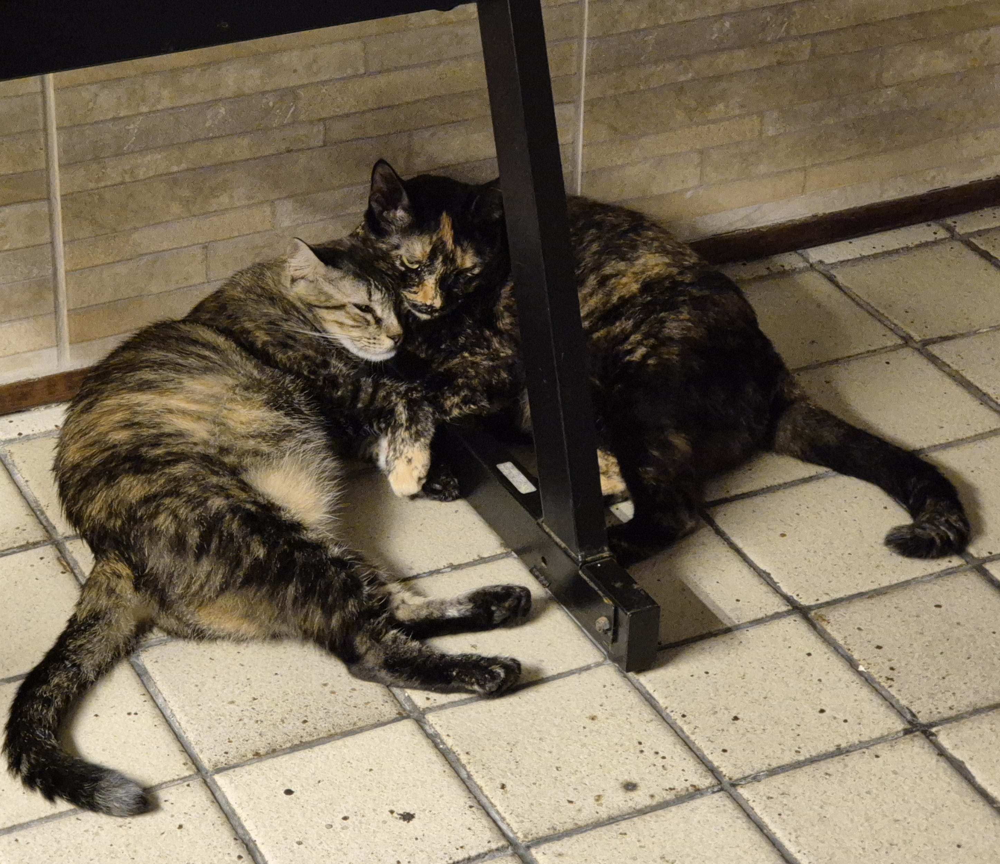

**OBS: Estou testando novas areias e ao longo do tempo vou atualizando essa postagem.**

Tenho duas gatinhas, Ártemis e Skadi (sim, duas deusas da caça, uma grega e a outra nórdica, respectivamente). Sempre digo que gatos não dão muito trabalho, pelo menos comparando-os aos cachorros. Só precisamos alimentar-los e limpar a caixinha de areia (tem outros pontos como brincar com eles, pentear, comprar arranhadores pra impedir que eles arranhem todos os móveis da casa... mas isso tudo é besteira).

O cuidado da caixinha de areia é o ponto mais trabalhoso pra cuidar de gatos, ou pelo menos era, at´e eu descobrir que estava usando areias de baixa qualidade que tornavam o trabalho todo muito mais difícil e nojento.

Por anos eu usava a areia pipicat (e semelhantes). É uma areia de pedrinhas que é bem baratinha. O problema é que ela não faz bons flocos em contato com o xixi, na verdade a mistura vira uma lama que fica com um cheiro horrível e vai criando um caldinho nojento que fica acumulando no fundo da caixinha. Depois que conheci as areias de milho e mandioca, tudo ficou mais fácil.

É verdade que as areias de milho e mandioca são mais caras, mas acho que valem o investimento. Na verdade talvez nem sejam mais caras, pois já que tudo fica mais limpo, dá pra espaçar mais as trocas completas de areia.  

Agora vamos sistematizar um pouco a análise das areias: as areias de milho e mandioca são melhores e ponto. Isso não se discute. Elas formam flocos duros de xixi que não se desmancham e deixam seco o fundo da caixiniha, eduzem o odor (quando tira o cocô e o xixi não fica nenhum cheiro), é muito fácil de limpar todo dia com a pasinha e ocorre menos desperdício. As areias de pedrinhas tipo a pipicat, apesar de serem mais baratas eu precisava repor areia a cada troca pois desperdiçava muito areia precisando tirar os excessos de areia suja pela lama que ficava.

## Pipicat

Pras minhas 2 gatas eu precisava usar 12 Kg de pipicat por mês. 1-2 vezes por semana pelo menos eu precisava encher a caixinha com mais areia pra tapar os buracos que ficavam. O pacote de 12 Kg custa em torno de **R$ 40,00 que era o meu gasto por mês**.

## Marcas de areias de milho e mandioca

## 

### Great Pets

O pacote vem com 3,8 Kg e custa em torno de R$ 45,00 reais. Pra o mês todo eu precisei usar um pacote e meio (em torno de 6 Kg). Foi suficiente pras 2 gatas pois o rendimento da areia é muito melhor. Eu conseguia jogar fora apenas o cocô e os flocos de xixi, conseguindo separar da areia limpa. Então **por mês o gasto ficou próximo de R$ 67,50**.

### Viva verde

Essa é a área mais "modinha", pelo que pesquisei, e também a mais vendida na Amazon.
