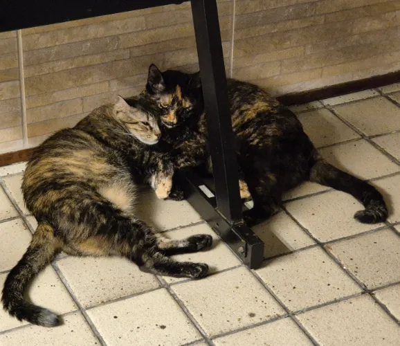
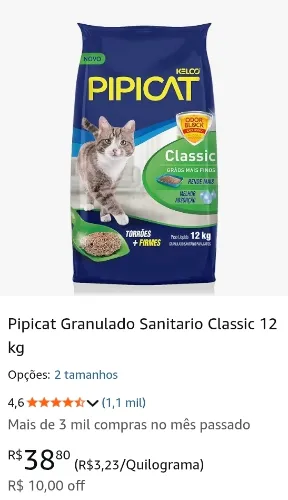
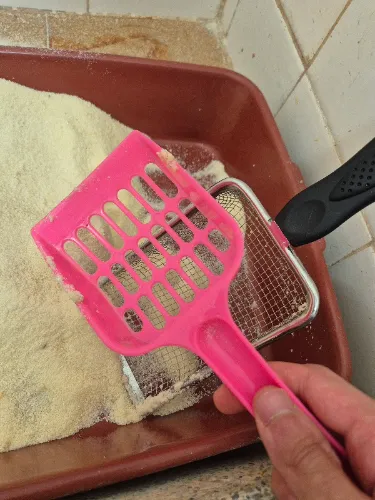
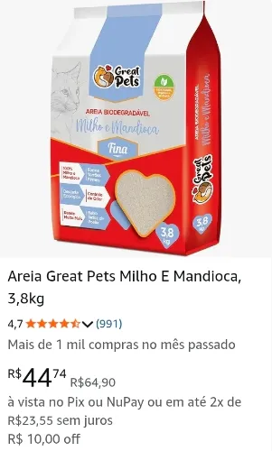
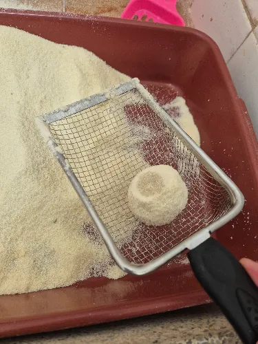
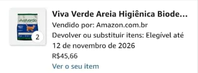

**OBS: Estou testando novas areias e ao longo do tempo vou atualizando essa postagem.**

Tenho duas gatinhas, Ártemis e Skadi (sim, duas deusas da caça, uma grega e a outra nórdica, respectivamente). Sempre digo que gatos não dão muito trabalho, pelo menos comparando-os aos cachorros. Só precisamos alimentar-los e limpar a caixinha de areia (tem outros pontos como brincar com eles, pentear, comprar arranhadores pra impedir que eles arranhem todos os móveis da casa... mas isso tudo são apenas detalhes).

O cuidado da caixinha de areia é o ponto mais trabalhoso pra cuidar de gatos, ou pelo menos era, até eu descobrir que estava usando areias de baixa qualidade que tornavam o trabalho todo muito mais difícil e nojento. O básico é: 1) encher a caixa de areia; 2) uma vez por dia jogar fora o cocô e o xixi; 3) a cada 15 ou 30 dias jogar toda a areia fora, lavar as caixas e colocar areia nova.

Por anos eu usava a areia Pipicat (e semelhantes). É uma areia de pedrinhas que é bem baratinha. O problema é que ela não forma bons flocos em contato com o xixi, na verdade a mistura vira uma lama que fica com um cheiro horrível e vai criando um caldo nojento que fica acumulando no fundo da caixinha. Depois que conheci as areias de milho e mandioca, tudo ficou mais fácil.

É verdade que as areias de milho e mandioca são mais caras, mas acho que valem o investimento. Na verdade talvez nem sejam mais caras pois, já que tudo fica mais limpo, dá pra espaçar mais as trocas completas de areia.  

Agora vamos sistematizar um pouco a análise das areias: as areias de milho e mandioca são melhores e ponto. Isso não se discute. Elas formam flocos duros de xixi que não se desmancham e deixam seco o fundo da caixinha. Elas reduzem o odor (quando tira o cocô e o xixi não fica nenhum cheiro na areia que sobrou). É muito fácil de limpar todo dia com a pazinha e ocorre menos desperdício. As areias de pedrinhas tipo a pipicat, apesar de serem mais baratas, eu precisava repor areia nova a cada limpa pois um grande raio de areia era contaminado pela lama que ficava (e mesmo assim sobrava a lama no fundo).

A seguir vou listar e analisear cada areia focando na análise de custo-benefício pra descobrir qual a melhor opção. A primeira vai ser a Pipicat que vai ser a _areia controle_ pra criar a base de gasto mensal e compara com as areias boa. As demais vão ser todas areias de _milho e mandioca_.

## Pipicat

Pras minhas 2 gatas eu precisava usar 12 Kg de pipicat por mês. 1-2 vezes por semana pelo menos eu precisava encher a caixinha com mais areia pra tapar os buracos que ficavam. O pacote de 12 Kg custa em torno de **R$ 40,00 que era o meu gasto por mês**.

Eu usava essa pazinha com furos grandes abaixo. Mais adiante vou explicar que precisei trocar pra outra pazinha com furos pequenininhos. Infezlimente não tenho fotos da época que usava a pipicat.

### Great Pets

O pacote vem com 3,8 Kg e custa em torno de R$ 45,00 reais. Pra o mês todo eu precisei usar um pacote e meio (em torno de 6 Kg). Foi suficiente pras duas gatas pois o rendimento da areia é muito melhor. Eu conseguia jogar fora apenas o cocô e os flocos de xixi, conseguindo separá-los da areia limpa ao redor. O grande divisor de águas é que o fundo da caixinha fica bem sequinho depois que tiro os flocos de xixi, sem formar aquela lama nojenta. Então, **por mês o gasto ficou próximo de R$ 67,50**.

Como a areia é bem fininha, precisei trocar a pazinha por uma com furinhos bem pequenos pra conseguir literalmente peneirar bem e tirar os floquinhos sujos de xixi ou cocô.

### Viva verde

Essa é a área mais "modinha" e também a mais vendida na Amazon. Comprei mas ainda não testei. Estou esperando dar o tempo de trocar a da Great Pets que estou usando. O preço dela costuma ser R$ 54,00 por 4 Kg mas de vez em quando aparecem umas promoções de "leve duas e cada uma sai por R$ 45,66", foi numa promoção dessas que comprei. Em breve venho atualizar o texto pra analisar como foi, se a experiência foi boa e quantos pacotes precisei usar no mês todo.

